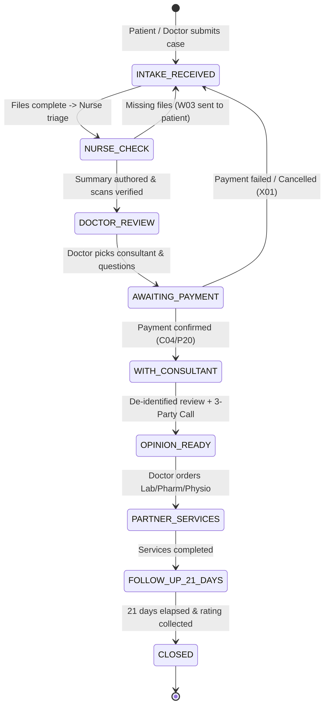

# ALO DOCTOR — Clinical Workflow & Connected Care Platform
> **Saudi Arabia Healthcare Edition (Aligned with Official Specification & Clinical Workflow Chain)**

Welcome to the **ALO DOCTOR** platform repository. This system is a coordinator-mediated medical second opinion and connected healthcare platform designed for Saudi Arabia, connecting local patients and licensed Saudi treating doctors with global super-specialists (e.g. KIMS, Aster, Fortis) and a local Saudi partner ecosystem (Pathology Labs, Pharmacies, Home Nursing, and Physiotherapy).

---

## ⚡ Quick Start: Single-Page Clinical Flow & Role Cockpit

To test and verify the entire end-to-end clinical workflow in **one single page** with no page reloads:

1. Open `index.html` directly in any web browser:
   ```bash
   open index.html
   ```
   *Or serve with any static web server:*
   ```bash
   npx serve .
   ```

### Cockpit Capabilities:
- **Universal Role Switcher Bar**: Switch instantly between the 11 roles:
  - `P`: Patient
  - `D`: Saudi Treating Doctor
  - `N`: ALO Nurse
  - `C`: ALO Coordinator
  - `K`: Indian Consultant
  - `L`: Lab Technician
  - `H`: Pharmacist
  - `T`: Physiotherapist
  - `V`: Home Nursing Tech
  - `HA`: Hospital Admin
  - `AD`: ALO Super Admin
- **Mandatory Condition Checklists**: Each of the 9 stages defines explicit pre-condition checkboxes.
- **Role Permission Enforcement**: Only the role assigned to the stage (or Super Admin) can tick the condition checkboxes.
- **Instant Stage Hand-off**: Clicking **"Verify & Hand-Off"** advances the state machine, records a timestamped audit entry in the real-time timeline ledger, and simulates WhatsApp notification dispatch (`W01`–`W20`).
- **Edge-Case Simulators**: Buttons for immediate simulation of exception flows (`X01`–`X16`).

---

## 🔄 The 9-Stage Master Clinical State Machine



---

## 🤖 Concurrent 5-Worker Architecture (Alibaba Key Pool)

The development and execution tasks have been decomposed into **5 independent GitHub Issues** in this repository to enable running **up to 5 concurrent AI processes/workers** without file conflicts:

| Stream / Issue | Target Stages | Roles | Primary Responsibilities |
| :--- | :--- | :--- | :--- |
| **[Issue #1](https://github.com/kathirvelmurugan/second-consult/issues/1)** | Stages 1 & 4 | `P`, `C` | Patient Intake, Saudi National ID/Iqama SMS OTP (`P02-P03`), Mada/Apple Pay webhook (`P19-P21`), WhatsApp `W01`-`W06`. |
| **[Issue #2](https://github.com/kathirvelmurugan/second-consult/issues/2)** | Stages 2 & 3 | `N`, `D` | Nurse Triage Desk (`N01-N07`), DICOM integrity check, WhatsApp `W03` missing scan request, Saudi Doctor 2-question authoring (`D03`), SLA timer (`X09`). |
| **[Issue #3](https://github.com/kathirvelmurugan/second-consult/issues/3)** | Stages 5 & 6 | `K`, `C` | Privacy Firewall (PII stripping), Consultant Workspace (English-only), 48h SLA acceptance (`X10`), 3-Party WebRTC Video Room (`P23`), Bilingual Stamped PDF (`P25`). |
| **[Issue #4](https://github.com/kathirvelmurugan/second-consult/issues/4)** | Stages 7 & 8 | `L`, `H`, `T`, `V`, `P` | Saudi Partner Care: Lab phlebotomy dispatch (`L01`), Pharmacy e-prescriptions & generic substitutions (`H01`/`X20`), Home nursing (`V01`), 21-Day Follow-up Chat (`P27`). |
| **[Issue #5](https://github.com/kathirvelmurugan/second-consult/issues/5)** | Stage 9 & Orchestrator | `AD`, `HA`, Universal | Master State Machine FSM, Real-Time Audit Ledger, Hospital & Test Catalog Administration, Case Closure & CSAT survey (`W20`). |

---

## 🔒 Security, Compliance & Data Sovereignty
1. **100% In-Kingdom Data Residency**: All medical scans, patient records, and audit logs reside strictly on Saudi Arabian infrastructure.
2. **Consultant Privacy Firewall**: International consultants receive rich medical diagnostic scans (MRI, CT, DICOM), but **zero patient PII** (names, phone numbers, and National IDs are strictly redacted).
3. **Audit Trail**: Every checklist tick and state hand-off generates an immutable event log recording `actorId`, `role`, `timestamp`, and `action`.
